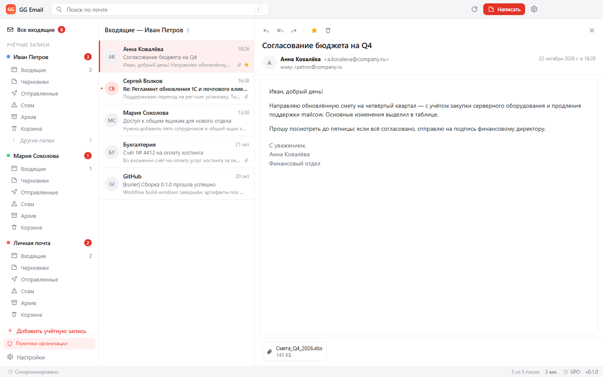
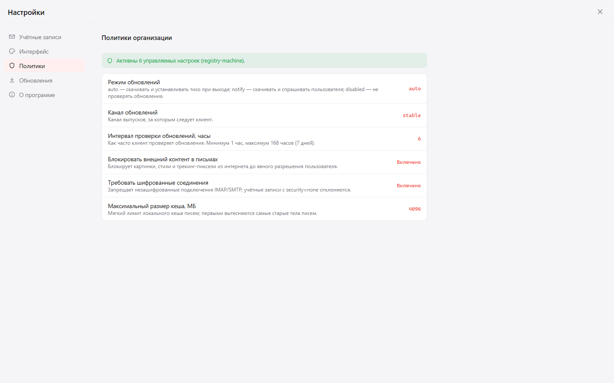

# GG Email — корпоративный почтовый клиент

GG Email — лёгкий почтовый клиент для Windows, созданный как замена Mozilla Thunderbird
в компании с собственным почтовым сервером **mailcow** и внешними ящиками
(Gmail, Яндекс, Mail.ru, любой IMAP/SMTP).



## Зачем

Thunderbird плохо подходит для управляемого парка рабочих мест:

| Проблема | Как решает GG Email |
|---|---|
| Кеш в mbox-файлах ломается, «Индекс повреждён», письма пропадают из списка | Кеш — SQLite (WAL + FTS5), тела писем сжаты, кеш можно удалить и восстановить с сервера в любой момент |
| Высокое потребление RAM и диска | Один процесс, список на виртуализации, тела писем загружаются по требованию, лимит кеша из политики |
| Несколько аккаунтов неудобны: общий список, путаница папок | «Все входящие» + отдельный цвет и дерево папок для каждого ящика, независимая синхронизация |
| Обновления требуют прав администратора | Установка per-user в `%LOCALAPPDATA%\Programs\GG Email`, дифференциальные автообновления |
| Нет управления через GPO | 22 политики ADMX/ADML: серверы, обновления, безопасность, кеш, интерфейс |
| Не работает с Gmail/Яндексом без «танцев» | Пресеты провайдеров, автонастройка, OAuth2 с client_id из политики, пароли приложений |

## Возможности

- **Мультиаккаунтность**: mailcow, Gmail, Яндекс, Mail.ru, Outlook.com, произвольный IMAP/SMTP.
- **Единый ящик**: «Все входящие» по всем аккаунтам, цветовые метки, раздельные папки.
- **Надёжный кеш**: SQLite WAL, инкрементальная синхронизация по UID/UIDVALIDITY,
  IMAP IDLE, периодическая сверка удалённых писем, полнотекстовый поиск FTS5.
- **Быстрый интерфейс**: React + виртуализированный список, тела писем по требованию.
- **Безопасность**: пароли в DPAPI (`safeStorage`), HTML-письма в sandboxed iframe с CSP,
  блокировка внешних картинок, запрет опасных вложений политикой, TLS 1.2+.
- **OAuth2** для Gmail и Яндекса (PKCE, loopback-redirect, client_id задаётся политикой).
- **Автонастройка**: внутренний autoconfig из политики → autoconfig домена → well-known →
  база Thunderbird ISPDB → встроенные пресеты → предположение `imap.<домен>`.
- **Обновления**: NSIS per-user, дифференциальные (blockmap), каналы stable/beta/internal,
  интервал, отсрочка установки и полное отключение — через GPO.
- **ADMX/ADML** с русской и английской локализацией, скрипты установки и создания GPO.
- **Веб-режим**: тот же клиент открывается в браузере (`npm run web`) — реальный IMAP/SMTP,
  тот же кеш и настройки, без установки Electron.

- **Сферы ящиков** в шапке: переключение между аккаунтами одним кликом, с числом непрочитанных.
- **Печать писем** через системный диалог с выбором принтера; печать вложений.
- **Вложений просмотр внутри приложения**: картинки, PDF и текст открываются в модальном окне,
  без перехода в новую вкладку браузера.
- **Экран «Хранилище»**: размер базы/тел/вложений, лимиты из политики, удаление тел писем
  и сжатие базы одним нажатием.
- **Обновления из GitHub**: релизы в [eeemihaeee/gg-email](https://github.com/eeemihaeee/gg-email),
  клиент проверяет `latest.yml` и скачивает дифференциальное обновление.

## Быстрый старт (разработка)

Требуется Node.js 22+ (проект проверен на Node 22.21 / Electron 45).

```powershell
npm install
npm run dev     # Electron-приложение
npm run web     # веб-режим: http://127.0.0.1:4173 (ссылка с токеном печатается в консоли)
```

> Если среда запрещает lifecycle-скрипты npm (песочницы, некоторые CI), используйте
> `npm install --ignore-scripts` и затем `node node_modules/electron/install.js`.
> Переменная `electron_config_cache` задаёт каталог загрузки бинарника.

### Приложение без Electron (для машин, где Electron не запускается)

Если `electron.exe` падает с `0xC0000005` (проверка: журнал «Просмотр событий → Приложение»),
используйте готовую сборку `release\GG-Email-Web`:

- `GG Email.exe` — лаунчер: поднимает локальный сервер на встроенном Node и открывает
  клиент в отдельном окне Edge (`--app`, без вкладок и адресной строки);
- структура папки важна: рядом должны лежать `node\` и `out\` — не переносите exe отдельно;
- профиль хранится в `%LOCALAPPDATA%\GG Email Web`, логи — в `launcher.log` там же;
- ярлык «GG Email» создаётся на рабочем столе.

Готовый архив для переноса на другие машины: `release\GG-Email-Web-0.3.0.zip` (32 МБ, Node внутри).
### Веб-режим

`npm run web` собирает renderer и серверный бандл, поднимает локальный HTTP-сервер
на `127.0.0.1:4173` и печатает ссылку с токеном доступа. В браузере доступен тот же
функционал: добавление ящиков, синхронизация, чтение, поиск, отправка, вложения, политики.
Данные лежат в `%APPDATA%\GG Email`; пароли шифруются AES-256-GCM ключом профиля
(в Electron — DPAPI через `safeStorage`).

Параметры: `GGEMAIL_PORT`, `GGEMAIL_HOST` (по умолчанию только localhost),
`GGEMAIL_TOKEN`, `GGEMAIL_USER_DATA`.

Демо-страница `?demo=1` (без сервера) показывает интерфейс на синтетических данных:
добавленные в ней ящики не синхронизируются — это витрина, а не рабочий режим.

Сборка и установщик:

```powershell
npm run build        # out/ (main, preload, renderer)
npm run dist         # release/GG-Email-Setup-<версия>.exe (NSIS, per-user)
```

Готовые артефакты в `release/`:

| Файл | Что это |
|---|---|
| `GG-Email-Setup-0.3.0.exe` | установщик NSIS, per-user, без прав администратора |
| `GG-Email-Setup-0.3.0.zip` | распакованное приложение: распакуйте в любую папку и запустите `GG Email.exe` |

### Если установщик не может записать «Uninstall GG Email.exe»

Окно «Невозможно открыть файл для записи: …\Uninstall GG Email.exe» означает, что файл
деинсталлятора занят: остался процесс прошлой установки, его сканирует антивирус или
запущен второй экземпляр установщика.

1. Установщик сам закрывает запущенные копии, начиная с 0.2.0 (сборка `38B1A2C9…`). Если у вас более ранняя сборка — закройте все окна установщика и GG Email (Диспетчер задач → снять задачи).
2. Удалите папку `%LOCALAPPDATA%\Programs\GG Email`, если она осталась.
3. Запустите установщик снова; если окно появится — нажмите «Повтор».
4. Если не помогает, используйте ZIP-сборку `GG-Email-Setup-0.3.0.zip`:
   распакуйте в `%LOCALAPPDATA%\Programs\GG Email` и запустите `GG Email.exe`.
   Она не создаёт деинсталлятор и не требует прав администратора.
Долгосрочное решение проблемы с антивирусом — подписать установщик сертификатом кода.

Проверки:

```powershell
npm run typecheck    # main + renderer
npm test             # 22 модульных теста (vitest)
npm run admx         # перегенерировать ADMX/ADML/README из каталога политик
```

### Если Electron не запускается (окно не появляется)

На некоторых рабочих станциях Electron падает до создания окна (в журнале
«Просмотр событий → Приложение» — ошибка `0xC0000005` в `electron.exe`). Это
проблема окружения, а не сборки: проверены Electron 22, 33, 37 и 45.

Рабочая альтернатива — запуск в браузере одним ярлыком:

```powershell
.\Start-GGEmail.cmd
```

Скрипт поднимает локальный сервер и открывает клиент в браузере. В Edge/Chrome
страницу можно закрепить как приложение: меню → «Приложения» → «Установить сайт
как приложение» — появится отдельное окно и ярлык.

Проверка причины: запустите любой другой Electron-клиент (например, VS Code).
Если он тоже не открывается — дело в политике/окружении Windows (антивирус,
WDAC/AppLocker, незакрытые обновления), а не в GG Email.


## Обновления из GitHub

Репозиторий: <https://github.com/eeemihaeee/gg-email>

- релиз собирается и публикуется командой `npm run dist:publish` или CI по тегу `v*`;
- electron-updater читает `latest.yml` из последнего GitHub Release и скачивает только разницу
  (blockmap), установка per-user без прав администратора;
- канал, интервал и отсрочка по-прежнему управляются политиками ADMX
  (`UpdateChannel`, `UpdateCheckIntervalHours`, `UpdateDeferDays`);
- для приватного репозитория автообновление потребует токен, поэтому репозиторий публичный.

## Политики



```powershell
# установить шаблоны (нужны права администратора)
.\policy\Install-GGEmailADMX.ps1 -Backup

# создать GPO с рекомендованными настройками (RSAT)
.\policy\New-GGEmailGPO.ps1 -AutoconfigUrl "https://autoconfig.company.ru/mail/config-v1.1.xml?emailaddress=%EMAIL%"
```

Политики читаются из `HKLM\SOFTWARE\Policies\GGEmail` и `HKCU\SOFTWARE\Policies\GGEmail`
(машинное значение приоритетнее). Полный справочник —
[policy/README.md](policy/README.md), руководство администратора —
[docs/ADMIN-GUIDE.md](docs/ADMIN-GUIDE.md).

## Документация

| Документ | Для кого |
|---|---|
| [docs/ARCHITECTURE.md](docs/ARCHITECTURE.md) | разработчики: устройство, синхронизация, кеш, безопасность |
| [docs/ADMIN-GUIDE.md](docs/ADMIN-GUIDE.md) | администраторы: развёртывание, ADMX, обновления, диагностика |
| [docs/USER-GUIDE.md](docs/USER-GUIDE.md) | пользователи: горячие клавиши, несколько ящиков, поиск |
| [docs/DEVELOPMENT.md](docs/DEVELOPMENT.md) | разработчики: сборка, тесты, добавление политик и провайдеров |
| [policy/README.md](policy/README.md) | справочник политик ADMX |

## Структура репозитория

```
src/
  main/            Electron main: IMAP/SMTP, кеш, синхронизация, политики, обновления
    db/            SQLite-схема, репозитории, сжатие
    mail/          imap, smtp, mime, autoconfig, oauth, sync
    policy.ts      чтение реестра GPO и слияние значений
    updater.ts     electron-updater + политики каналов/отсрочки
    ipc.ts         типизированные IPC-обработчики
  preload/         contextBridge-API (window.kurier)
  renderer/        React-интерфейс (zustand, виртуальный список, DOMPurify)
  shared/          типы, каталог политик, провайдеры, IPC-контракт
policy/            сгенерированные ADMX/ADML, скрипты установки и GPO
tools/             генератор ADMX, статический сервер для визуальных проверок
tests/             модульные тесты (vitest)
build/             иконка и NSIS-включения
```

## Статус и ограничения MVP

Собрано, опубликовано и проверено:

- релиз [v0.3.0](https://github.com/eeemihaeee/gg-email/releases/tag/v0.3.0):
  `GG-Email-Setup-0.3.0.exe` (109,8 МБ, SHA-256
  `CEBD5D2C05EE855F60CE4833565BABAB4F5FA88D0888575FD52338860FC47DB9`),
  `latest.yml`, blockmap и ZIP-сборка — автообновление работает через GitHub Releases;
- `npm test`: 22 модульных теста (политики, роли папок, кеш SQLite, FTS, флаги, сжатие, вытеснение);
- `npm run typecheck`: main + renderer без ошибок;
- интерфейс 0.3.0 проверен в headless Chromium: сферы ящиков в шапке, печать письма,
  просмотр вложений (картинка/PDF/текст), экран «Хранилище» со статистикой кеша;
- веб-режим (`npm run web`) с реальным IMAP: автонастройка `pm@itxr.ru` →
  `mail.itxr.ru:993/465`, ошибка входа показывает код сервера и подсказку.

Не проверено в среде сборки:

- запуск GUI Electron на этой машине: `electron.exe` падает с `0xC0000005` до `app.ready`
  (проверены Electron 22/33/37/45) — проблема окружения Windows, не сборки;
  для работы используйте веб-режим или машину без этого ограничения;
- живая синхронизация с реальным паролем и OAuth2 end-to-end (нужны учётные данные и client_id).

Ограничения текущего MVP:

- интерфейс локализован на русский (политика `DefaultLanguage` зарезервирована);
- нет календаря, адресной книги и S/MIME;
- черновики хранятся только на сервере (локального автосохранения пока нет);
- `PreconfiguredAccounts` читается, но мастер пока не подставляет шаблоны автоматически.

## Лицензия

Внутренний проект (`UNLICENSED`).
